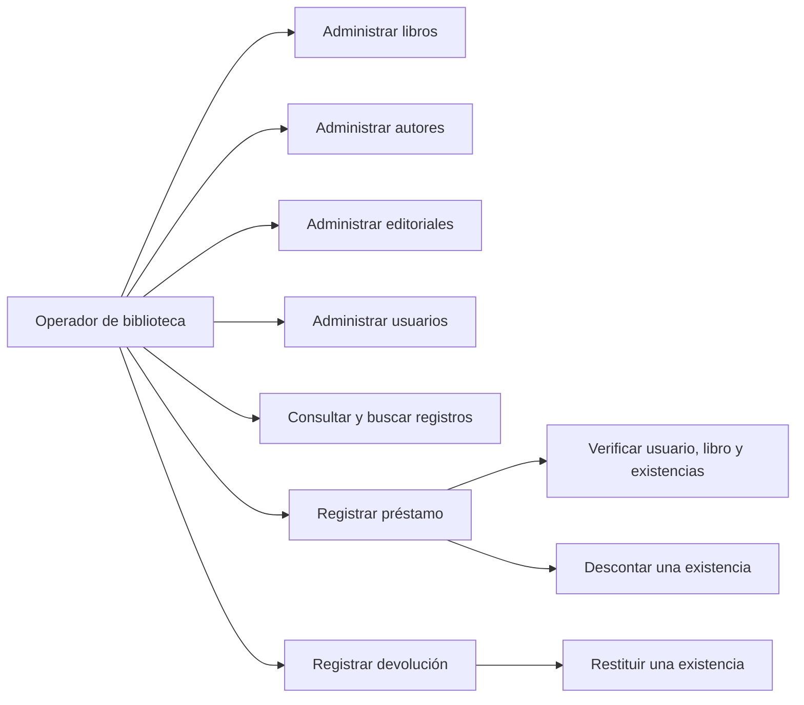
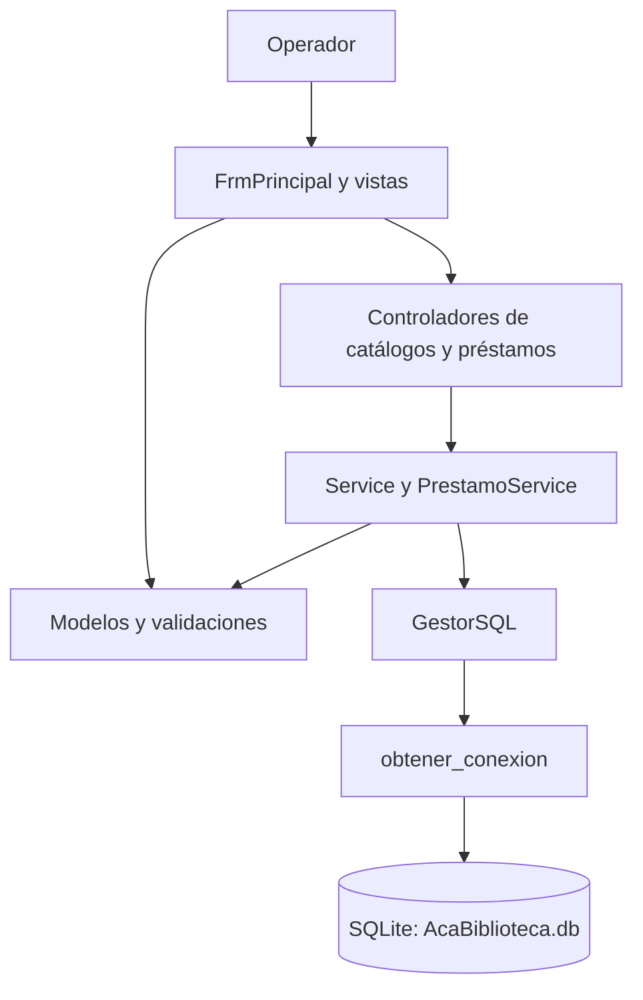
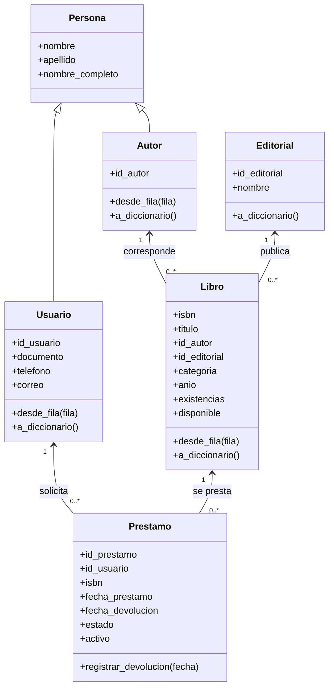
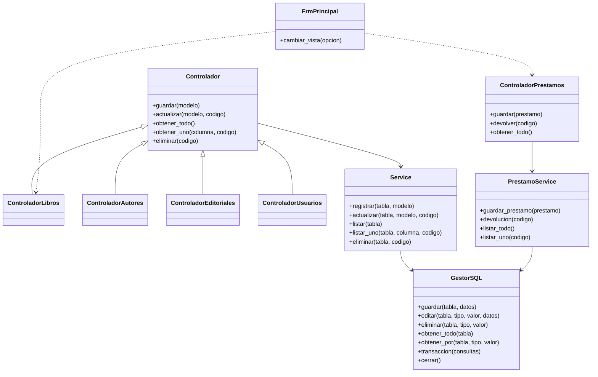
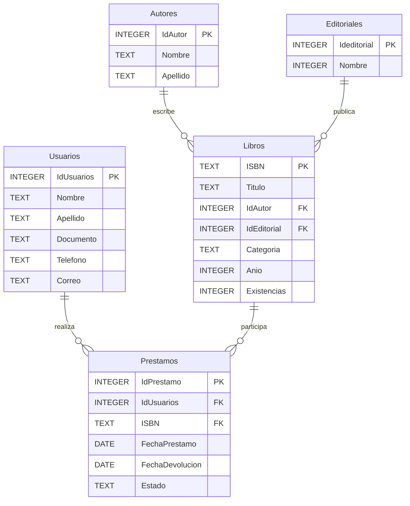
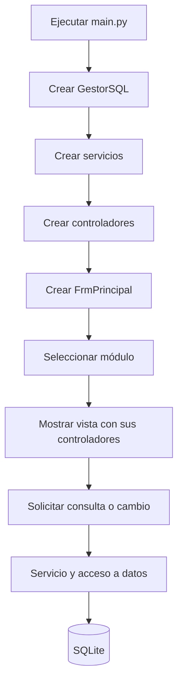
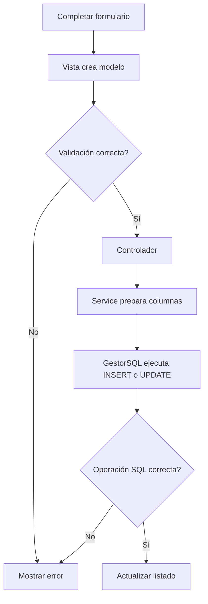
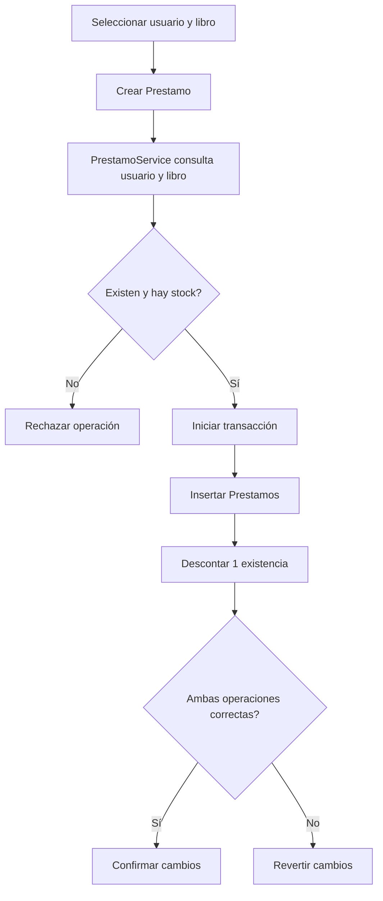
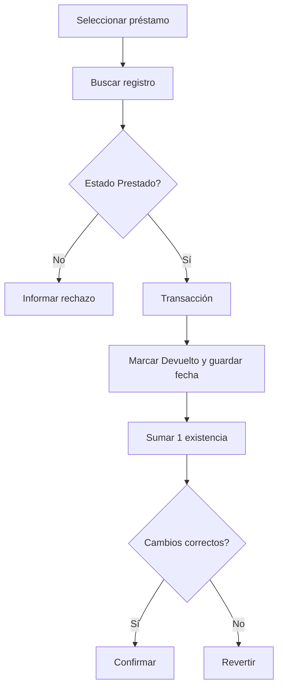

# ACABIBLIOTECA

## Documentación técnica del proyecto de software

**Institución:** (CUN) Corporacion Unificada Nacional de Educacion Superior  
**Programa académico:** Ingeniereia de Sistemas  
**Asignatura:** Programacion Avanzada  
**Integrantes:** 
- David Fernando Sanchez Robayo: 54467
- Enyember Johan Barragán Henao: 54460
- Sayra Daniela Gonzalez Diaz: 54463
- Yeiner David Charris Tapia: 54463

**Docente:** Veronica Castro

**Fecha:** 10 de noviembre de 2026  

**Propósito del proyecto:** Describir, analizar y documentar la arquitectura, los módulos y el funcionamiento de AcaBiblioteca, una aplicación académica de gestión bibliotecaria elaborada con Python, SQLite y tecnologías de interfaz gráfica de escritorio.

---


# Tabla de contenido

1. [Introducción](#1-introducción)
2. [Objetivos](#2-objetivos)
3. [Planteamiento del problema](#3-planteamiento-del-problema)
4. [Descripción general y alcance](#4-descripción-general-y-alcance)
5. [Análisis de requerimientos](#5-análisis-de-requerimientos)
6. [Casos de uso](#6-casos-de-uso)
7. [Arquitectura y estructura de carpetas](#7-arquitectura-y-estructura-de-carpetas)
8. [Explicación de módulos y archivos](#8-explicación-de-módulos-y-archivos)
9. [Diseño de clases](#9-diseño-de-clases)
10. [Modelo entidad-relación](#10-modelo-entidad-relación)
11. [Diccionario de datos](#11-diccionario-de-datos)
12. [Conexión y operaciones con SQLite](#12-conexión-y-operaciones-con-sqlite)
13. [Interfaz gráfica y funcionamiento](#13-interfaz-gráfica-y-funcionamiento)
14. [Flujos de operación](#14-flujos-de-operación)
15. [Instalación y ejecución](#15-instalación-y-ejecución)
16. [Pruebas y evidencias](#16-pruebas-y-evidencias)
17. [Hallazgos técnicos y oportunidades de mejora](#17-hallazgos-técnicos-y-oportunidades-de-mejora)
18. [Conclusiones](#18-conclusiones)
19. [Recomendaciones](#19-recomendaciones)
20. [Referencias bibliográficas](#20-referencias-bibliográficas)
21. [Anexos](#21-anexos)

---

# 1. Introducción

AcaBiblioteca es una aplicación académica de escritorio desarrollada en **Python** para administrar información bibliotecaria. Permite trabajar con libros, autores, editoriales y usuarios, además de registrar préstamos y devoluciones. La información se almacena localmente en una base de datos **SQLite**, lo cual permite conservar los registros entre sesiones siempre que se haya inicializado la base correspondiente.

La interfaz gráfica está construida con **CustomTkinter**, **Tkinter** y `ttk.Treeview`, y dispone de una ventana principal desde la cual se accede a las secciones del sistema. Las operaciones se distribuyen entre **vistas**, **controladores**, **servicios**, **modelos con validaciones** y **acceso a datos**. Esta separación facilita explicar el flujo de la información y mantener el código organizado.

El sistema incorpora formularios y tablas para las entidades principales, operaciones de registro, consulta, actualización y eliminación, y un proceso de préstamos que consulta la disponibilidad, descuenta una existencia al prestar y la restituye cuando se registra la devolución. Estas operaciones están desarrolladas en el código; su funcionamiento completo en una instalación concreta debe confirmarse con pruebas de ejecución.

Este documento presenta los objetivos, los requerimientos, la arquitectura, los casos de uso, los diagramas, el modelo relacional, las funciones de cada módulo, las instrucciones de instalación y las evidencias necesarias para evaluar el proyecto. También distingue los componentes implementados de los aspectos por corregir o verificar.

# 2. Objetivos

## 2.1 Objetivo general

Desarrollar una aplicación de escritorio para la gestión bibliotecaria mediante Python y SQLite, que permita administrar libros, autores, editoriales y usuarios, así como registrar préstamos y devoluciones con control de existencias.

## 2.2 Objetivos específicos

- Diseñar e implementar una base de datos relacional que conecte libros, autores, editoriales, usuarios y préstamos.
- Crear interfaces gráficas para registrar, consultar, modificar y eliminar la información bibliotecaria pertinente.
- Aplicar modelos de datos y reglas de validación para controlar los valores ingresados desde los formularios.
- Organizar el sistema en capas de presentación, control, servicios, modelos y persistencia.
- Implementar el registro de préstamos y devoluciones mediante transacciones que actualicen tanto los movimientos como las existencias.
- Comprobar mediante pruebas funcionales que las operaciones se ejecuten correctamente y que los cambios se mantengan en la base de datos.
- Documentar la estructura, el funcionamiento, las decisiones de diseño y las oportunidades de mejora del sistema.

# 3. Planteamiento del problema

## 3.1 Descripción del problema

La administración de una biblioteca requiere mantener información organizada sobre sus materiales, autores, editoriales, usuarios y movimientos de préstamo. Cuando estos datos se almacenan de manera dispersa o se actualizan manualmente, pueden surgir dificultades para localizar registros, relacionar información y controlar las existencias disponibles.

Como ejercicio académico, AcaBiblioteca aborda la necesidad de estructurar estos datos dentro de una aplicación informática. No se identificó en los archivos una biblioteca real específica, entrevistas ni mediciones de un proceso existente; por tanto, la problemática se presenta como un **escenario general de gestión bibliotecaria**, no como un diagnóstico comprobado de una institución determinada.

## 3.2 Formulación del problema

¿Cómo construir un sistema de escritorio en Python que permita organizar la información bibliotecaria en SQLite y proporcione una interfaz para consultar y gestionar los registros de libros, autores, editoriales, usuarios y préstamos?

## 3.3 Justificación

AcaBiblioteca permite poner en práctica la creación de tablas relacionadas, el uso de llaves primarias y foráneas, la ejecución de sentencias SQL, la separación del código en módulos y el desarrollo de interfaces gráficas.

Desde el punto de vista formativo, el sistema sirve para comprender cómo una interfaz solicita operaciones, cómo una capa de acceso a datos ejecuta consultas y cómo la base de datos conserva los registros. El trabajo permite además integrar la interfaz con controladores, modelos, servicios y persistencia, y analizar la consistencia de las operaciones de préstamo y devolución.

# 4. Descripción general y alcance

## 4.1 ¿Qué es AcaBiblioteca?

Es una aplicación de escritorio con una ventana principal y un menú que permite acceder a **Inicio, Libros, Autores, Editoriales, Usuarios y Préstamos**, además de una opción de salida. Las secciones trabajan con información almacenada en SQLite. Su propósito es apoyar las operaciones habituales de registro y consulta de una biblioteca en un contexto académico.

El proyecto no implementa autenticación, cuentas con privilegios diferenciados, reservas en línea ni servicios web. Los «usuarios» registrados son personas que pueden recibir préstamos, no cuentas de acceso al programa.

## 4.2 Tecnologías empleadas

| Tecnología | Uso real |
|---|---|
| Python | Lógica de la aplicación, validaciones y coordinación de componentes |
| SQLite / `sqlite3` | Base de datos relacional local, consultas SQL y transacciones |
| CustomTkinter | Ventanas, formularios, botones y navegación de escritorio |
| Tkinter y `ttk.Treeview` | Mensajes, cuadros de diálogo y tablas de registros |
| Pillow (`PIL`) | Lectura de imágenes utilizadas en el menú principal |
| `pathlib`, `contextlib`, `datetime`, `re` | Rutas, contextos, fechas y comprobación de formatos |
| Git | Control de versiones y configuración de archivos excluidos |

**Dependencias:** `requirements.txt` contiene `customtkinter`. En el código también aparecen `PIL` (Pillow) y una importación de `pendulum` que no se utiliza; deben revisarse al preparar una instalación reproducible.

## 4.3 Funcionalidades incluidas en el código

- **Libros:** registro, listado, búsqueda, actualización, eliminación, selección de autor y editorial, validación de ISBN y existencias.
- **Autores:** alta, listado, búsqueda, modificación y eliminación.
- **Editoriales:** alta, listado, búsqueda, modificación y eliminación.
- **Usuarios:** registro y administración de datos personales básicos, con comprobaciones de formato.
- **Préstamos:** creación y consulta de movimientos, validación de existencia disponible y devolución con ajuste de inventario.
- **Navegación:** cambio de vistas desde una única ventana principal.

Estas capacidades están **implementadas en el código fuente**. No se afirma que cada escenario haya superado una prueba gráfica o de integración; ese resultado debe anotarse en el capítulo 16.

## 4.4 Límites del alcance

El inventario se controla como una cantidad por ISBN, no como una colección de ejemplares individualizados. La devolución se registra en la tabla `Prestamos`, sin una tabla adicional. El sistema requiere que la base SQLite haya sido creada previamente: el arranque actual no ejecuta de manera automática el script de inicialización.

# 5. Análisis de requerimientos

Los siguientes requerimientos representan las capacidades diseñadas y desarrolladas a partir de la implementación actual. **«Implementado» significa que existe código para la función, no que se hayan verificado todas las rutas de ejecución.**

## 5.1 Requerimientos funcionales

| Código | Requerimiento | Evidencia y estado |
|---|---|---|
| RF-01 | Registrar, consultar, actualizar y eliminar autores | Vista, controlador, modelo y servicio; implementado en código |
| RF-02 | Registrar, consultar, actualizar y eliminar editoriales | Vista, controlador, modelo y servicio; implementado en código |
| RF-03 | Registrar, consultar, actualizar y eliminar libros | Vista, controlador, modelo y servicio; implementado en código |
| RF-04 | Registrar, consultar, actualizar y eliminar usuarios | Vista, controlador, modelo y servicio; implementado en código |
| RF-05 | Buscar registros y seleccionar resultados en tablas | Métodos de búsqueda y eventos de selección en las vistas; implementado en código |
| RF-06 | Validar campos obligatorios y formatos | `modelos/validaciones.py` y propiedades de los modelos; implementado |
| RF-07 | Registrar préstamos asociados a un usuario y un ISBN | `Prestamo`, `ControladorPrestamos` y `PrestamoService`; implementado en código |
| RF-08 | Impedir préstamos sin unidades disponibles | Comprobación de `Existencias` y actualización condicionada; implementado |
| RF-09 | Descontar una existencia al registrar el préstamo | Transacción que inserta el préstamo y actualiza el libro; implementado |
| RF-10 | Registrar la devolución de un préstamo activo | Cambio a estado `Devuelto`, fecha y aumento de existencias; implementado |
| RF-11 | Consultar los movimientos de préstamos | Listado y consulta por identificador; implementado |
| RF-12 | Navegar por los módulos desde una ventana principal | `FrmPrincipal` y `main.py`; implementado |
| RF-13 | Conservar operaciones en SQLite | Capa `GestorSQL` con `commit` y `rollback`; disponible, por probar en ejecución integrada |

## 5.2 Requerimientos no funcionales

| Código | Requerimiento | Implementación / aspecto a verificar |
|---|---|---|
| RNF-01 | Interfaz comprensible y consistente | Estilos compartidos y vistas de escritorio; evaluar usabilidad |
| RNF-02 | Integridad referencial | `PRAGMA foreign_keys = ON` en cada conexión; verificar con pruebas |
| RNF-03 | Consistencia de préstamos | Transacciones de múltiples sentencias y comprobación de filas afectadas |
| RNF-04 | Validación de entrada | Modelos y funciones reutilizables de validación |
| RNF-05 | Mantenibilidad | Separación en vistas, controladores, servicios, modelos y datos |
| RNF-06 | Persistencia local | Archivo SQLite en `database/AcaBiblioteca.db` |
| RNF-07 | Reproducibilidad | Requiere complementar dependencias e inicialización de la base |
| RNF-08 | Manejo de errores | Captura parcial de errores SQL y mensajes de interfaz; revisar resultados devueltos por préstamos |

## 5.3 Actores

**Operador de biblioteca:** persona que utiliza la aplicación para gestionar catálogos, usuarios y préstamos. Es un actor funcional del sistema, **no un rol autenticado**. Los usuarios inscritos en la biblioteca son registros del dominio y no necesariamente operadores del software.

# 6. Casos de uso

## 6.1 Diagrama general



Las acciones «Administrar» comprenden, según la pantalla correspondiente, las operaciones de registrar, consultar, actualizar y eliminar.

## 6.2 CU-01: Administrar libro

| Elemento | Descripción |
|---|---|
| Actor | Operador de biblioteca |
| Precondiciones | Base de datos inicializada y autor y editorial registrados |
| Flujo principal | 1. Abrir Libros. 2. Ingresar datos y seleccionar autor/editorial. 3. Guardar. 4. La vista construye un `Libro` validado. 5. El controlador solicita al servicio registrar. 6. El gestor ejecuta la operación SQL. 7. Se actualiza el listado. |
| Alternativas | Buscar por identificador, seleccionar un registro, actualizar sus datos o solicitar eliminación con confirmación |
| Excepciones | ISBN inválido o duplicado, campos faltantes, existencias negativas o relaciones inexistentes |
| Resultado esperado | Registro persistido o mensaje de rechazo |
| Estado | Implementado en código; pendiente de evidencia de ejecución |

## 6.3 CU-02: Administrar autores y editoriales

| Elemento | Descripción |
|---|---|
| Actor | Operador de biblioteca |
| Flujo | Abrir la sección, completar el formulario, registrar o seleccionar un elemento; consultar, actualizar o eliminar mediante el controlador y el servicio |
| Validaciones | Nombre obligatorio, identificadores numéricos y restricciones referenciales al eliminar |
| Resultado esperado | Catálogo actualizado |
| Estado | Implementado en código; pendiente de verificación funcional |

## 6.4 CU-03: Administrar usuarios

| Elemento | Descripción |
|---|---|
| Actor | Operador de biblioteca |
| Flujo | Registrar nombre, apellido, documento, teléfono y correo; consultar, seleccionar, actualizar o eliminar registros |
| Validaciones | Funciones del modelo `Usuario` y `validaciones.py` |
| Resultado esperado | Información del usuario persistida para su uso en préstamos |
| Estado | Implementado en código; pendiente de pruebas |

## 6.5 CU-04: Registrar préstamo

| Elemento | Descripción |
|---|---|
| Actor | Operador de biblioteca |
| Precondiciones | Usuario y libro existentes; existencia mayor que cero |
| Flujo | 1. Abrir Préstamos. 2. Seleccionar usuario y libro. 3. Confirmar. 4. Crear y validar `Prestamo`. 5. Consultar existencia. 6. Ejecutar una transacción que inserta el movimiento y descuenta una unidad. |
| Alternativas | Si no existe usuario, libro o inventario disponible, se rechaza la operación |
| Resultado esperado | Préstamo en estado `Prestado` e inventario reducido en una unidad |
| Estado | Implementado en código; verificar tratamiento visual de resultados de error |

## 6.6 CU-05: Registrar devolución

| Elemento | Descripción |
|---|---|
| Actor | Operador de biblioteca |
| Precondiciones | Préstamo existente y estado `Prestado` |
| Flujo | 1. Seleccionar préstamo. 2. Solicitar devolución. 3. Comprobar estado. 4. Cambiar a `Devuelto`, registrar fecha y aumentar la existencia del libro dentro de una transacción. |
| Alternativas | Si ya fue devuelto o no existe, no se debe efectuar una segunda devolución |
| Resultado esperado | Historial actualizado y una unidad restituida |
| Estado | Implementado en código; pendiente de evidencia de prueba |

# 7. Arquitectura y estructura de carpetas

## 7.1 Organización del proyecto

```text
AcaBiblioteca-main/
├── main.py
├── requirements.txt
├── .gitignore
├── .gitattributes
├── Documentación.md
├── controladores/
│   ├── controlador_prestamo.py
│   └── controladores.py
├── database/
│   └── schema_y_datos.sql
├── datos/
│   ├── conexion.py
│   └── gestor_sql.py
├── modelos/
│   ├── persona.py
│   ├── autor.py
│   ├── editorial.py
│   ├── libro.py
│   ├── usuario.py
│   ├── prestamo.py
│   └── validaciones.py
├── servicios/
│   ├── service.py
│   └── prestamo_service.py
├── vistas/
│   ├── vista_main.py
│   ├── vista_libros.py
│   ├── vista_autores.py
│   ├── vista_editoriales.py
│   ├── vista_usuarios.py
│   └── vista_prestamos.py
├── utils/
│   ├── estilos.py
│   └── [imágenes para navegación y logotipo]
└── docs/
    └── imagenes/
```

Las carpetas de código también contienen archivos `__init__.py` para su organización como paquetes de Python. **El archivo `database/AcaBiblioteca.db` es la ubicación esperada por el programa, pero debe generarse antes del uso si aún no existe.**

## 7.2 Arquitectura por responsabilidades



**Presentación:** las vistas reciben datos, muestran tablas y notifican errores. **Control:** los controladores adaptan las solicitudes de las vistas a los servicios. **Servicio:** `Service` prepara y valida qué columnas se envían a cada tabla; `PrestamoService` implementa las reglas del movimiento de inventario. **Modelos:** representan entidades con propiedades y validaciones. **Persistencia:** `GestorSQL` ejecuta consultas y `conexion.py` configura SQLite.

La organización se aproxima a una arquitectura en capas inspirada en MVC, aunque no es necesario presentarla como una implementación estricta y completa de un patrón formal.

# 8. Explicación de módulos y archivos

## 8.1 `main.py`: punto de entrada

Es el archivo que ensambla la aplicación. Configura el modo de apariencia, construye un único `GestorSQL`, crea `Service` y `PrestamoService`, instancia los controladores de libros, autores, editoriales, usuarios y préstamos, y los entrega a `FrmPrincipal`. Finalmente llama a `mainloop()` para iniciar la interfaz. Al cerrar la ventana por el control de cierre, ejecuta `gestor.cerrar()`.

## 8.2 `vistas/vista_main.py`: navegación

Define `FrmPrincipal`, que hereda de `customtkinter.CTk`. Configura una ventana de 1200 × 700 píxeles, un menú lateral con imágenes, un mensaje inicial y un contenedor para los módulos. `cambiar_vista(opcion)` destruye el contenido actual y crea la vista solicitada. Las imágenes se cargan con Pillow mediante rutas relativas a `utils/`.

## 8.3 Vistas de gestión

| Archivo / clase | Función principal |
|---|---|
| `vista_libros.py` / `VistaLibros` | Formulario con ISBN, título, autor, editorial, categoría, año y existencias; registro, consulta, edición, eliminación y listado |
| `vista_autores.py` / `VistaAutores` | Administración de nombres y apellidos de autores |
| `vista_editoriales.py` / `VistaEditoriales` | Administración de nombres de editoriales |
| `vista_usuarios.py` / `VistaUsuarios` | Administración de nombre, apellido, documento, teléfono y correo |
| `vista_prestamos.py` / `VistaPrestamo` | Selección de usuario y libro, registro, consulta y devolución de préstamos |

Las vistas utilizan formularios, botones, eventos de selección, mensajes y tablas `ttk.Treeview`. Los métodos `refrescar`, `cargar_tabla`, `obtener_datos`, `llenar_formulario` y `limpiar` ayudan a coordinar los controles con los datos. En particular, la vista de préstamos carga opciones de usuarios y libros con información de los demás controladores.

## 8.4 `controladores/controladores.py`

Contiene una clase base `Controlador`, que recibe un servicio y el nombre de la tabla. Expone métodos `guardar`, `actualizar`, `obtener_todo`, `obtener_uno` y `eliminar`. Las clases `ControladorLibros`, `ControladorAutores`, `ControladorEditoriales` y `ControladorUsuarios` especializan esa clase seleccionando la tabla correspondiente.

## 8.5 `controladores/controlador_prestamo.py`

Define `ControladorPrestamos` con métodos `guardar`, `devolver`, `obtener_todo` y `obtener_uno`. Delega la lógica específica a `PrestamoService`.

## 8.6 `servicios/service.py`

La clase `Service` concentra operaciones genéricas de registro, actualización, listado, consulta individual y eliminación. Usa un mapa de identificadores por tabla y una lista de columnas permitidas para preparar los diccionarios enviados a SQL. Al guardar libros elimina los campos de presentación `Autor` y `Editorial`, y convierte `Anio` en el nombre real de columna `Año`.

En los listados transforma filas de SQLite a objetos de las clases `Libro`, `Autor`, `Editorial` y `Usuario`, utilizando `desde_fila()`.

## 8.7 `servicios/prestamo_service.py`

La clase `PrestamoService` concentra las reglas de préstamo y devolución. Al prestar comprueba la existencia de usuario y libro, verifica que el inventario sea positivo y llama a `GestorSQL.transaccion()` con dos sentencias: insertar en `Prestamos` y reducir `Libros.Existencias`. Al devolver consulta el préstamo, comprueba que esté activo, registra fecha y estado, y aumenta las existencias en una transacción.

**Precaución:** en determinadas validaciones devuelve un texto con el error y en otras rutas devuelve un booleano. Esa diferencia debe atenderse al interpretar resultados en la vista, porque una cadena no vacía tiene valor verdadero en Python.

## 8.8 Modelos y validaciones

| Modelo | Responsabilidad |
|---|---|
| `Persona` | Datos comunes: nombre, apellido y nombre completo |
| `Autor(Persona)` | Datos del autor e identificador |
| `Usuario(Persona)` | Identificador, documento, teléfono y correo |
| `Editorial` | Identificador y nombre de editorial |
| `Libro` | ISBN, título, vínculos con autor/editorial, categoría, año, existencias y disponibilidad |
| `Prestamo` | Usuario, libro, fechas, estado y acción de registrar devolución |
| `validaciones.py` | Campos obligatorios, enteros, identificadores, correo, dígitos y fechas |

Los modelos implementan propiedades, constructores y métodos de conversión entre diccionarios, filas y objetos. Por ejemplo, `Libro` admite ISBN de 10 o 13 dígitos (sin verificar el dígito de control), comprueba existencias no negativas y permite año opcional; `Prestamo` limita estados a `Prestado` y `Devuelto`.

## 8.9 `datos/conexion.py`

Construye la ruta `database/AcaBiblioteca.db`; `obtener_conexion()` abre SQLite, ejecuta `PRAGMA foreign_keys = ON` y establece `sqlite3.Row`. El administrador de contexto `conexion()` confirma, revierte y cierra una conexión dentro de un bloque `with`. El gestor principal, por su parte, utiliza `obtener_conexion()` directamente y conserva una conexión abierta hasta el cierre del programa.

## 8.10 `datos/gestor_sql.py`

Implementa `GestorSQL` con métodos `guardar`, `obtener_todo`, `obtener_por`, `editar`, `eliminar`, `buscar_libros`, `transaccion`, `cancelar` y `cerrar`. Las operaciones CRUD usan parámetros `?` para valores. `buscar_libros()` incluye una consulta `JOIN` entre libros, autores y editoriales, con filtros por ISBN, título, categoría y nombres relacionados. `transaccion()` agrupa varias consultas y ejecuta `rollback()` si una falla o si no afecta la cantidad esperada de filas.

## 8.11 `database/schema_y_datos.sql` y `utils/estilos.py`

El script SQL define las cinco tablas y sus registros iniciales. `estilos.py` reúne constantes de colores, fuentes y dimensiones, usadas para dar uniformidad a las pantallas. El repositorio también contiene imágenes de navegación en `utils/`, instrucciones de dependencias en `requirements.txt` y configuración Git.

# 9. Diseño de clases

## 9.1 Diagrama de clases de dominio



Las asociaciones representan las relaciones del dominio; los objetos de modelo guardan principalmente identificadores, no referencias directas a otros objetos.

## 9.2 Diagrama simplificado de componentes de control



La ventana principal recibe los controladores desde `main.py` y los pasa a cada vista cuando corresponde; no crea directamente la capa de acceso a datos.

# 10. Modelo entidad-relación

## 10.1 Diagrama ER



> Para facilitar el diagrama, `Anio` representa el campo **`Año`** definido literalmente en SQL. El diagrama conserva `Editoriales.Nombre` como INTEGER porque así está declarado en el archivo original, aunque el tipo recomendado es TEXT.

## 10.2 Explicación de relaciones

- **Autores 1:N Libros:** un autor puede aparecer asociado a varios libros; cada libro contiene un `IdAutor`.
- **Editoriales 1:N Libros:** una editorial puede publicar varios libros; cada libro contiene un `IdEditorial`.
- **Usuarios 1:N Prestamos:** un usuario puede tener varios préstamos; cada préstamo referencia un usuario.
- **Libros 1:N Prestamos:** un libro identificado por ISBN puede estar asociado con varios registros de préstamo a lo largo del tiempo.

El esquema **no** incluye una tabla independiente de devoluciones; su información se contempla en `Prestamos.FechaDevolucion` y `Prestamos.Estado`. Tampoco hay una entidad para ejemplares individuales: `Existencias` representa una cantidad en el registro de un libro.

# 11. Diccionario de datos

Las restricciones indicadas se derivan de `database/schema_y_datos.sql` en la versión actual. `PK` significa clave primaria, `FK` clave foránea y `NN` campo obligatorio (`NOT NULL`).

## 11.1 Tabla `Autores`

| Campo | Tipo SQL | Restricciones | Descripción |
|---|---|---|---|
| `IdAutor` | INTEGER | PK, AUTOINCREMENT | Identificador del autor |
| `Nombre` | TEXT | NN | Nombre o nombres |
| `Apellido` | TEXT | NN | Apellido o apellidos |

## 11.2 Tabla `Editoriales`

| Campo | Tipo SQL | Restricciones | Descripción |
|---|---|---|---|
| `Ideditorial` | INTEGER | PK, AUTOINCREMENT | Identificador de editorial |
| `Nombre` | INTEGER | NN | Nombre de editorial; **debería ser TEXT** |

SQLite emplea afinidad de tipos flexible; por ello se pueden insertar los valores de texto existentes en una columna declarada INTEGER, pero el esquema presenta una incoherencia que conviene corregir.

## 11.3 Tabla `Libros`

| Campo | Tipo SQL | Restricciones | Descripción |
|---|---|---|---|
| `ISBN` | TEXT | PK | Identificador ISBN del libro |
| `Titulo` | TEXT | NN | Título |
| `IdAutor` | INTEGER | NN, FK | Referencia a `Autores.IdAutor` |
| `IdEditorial` | INTEGER | NN, FK | Referencia a `Editoriales.IdEditorial` |
| `Categoria` | TEXT | NN | Género o categoría |
| `Año` | INTEGER | Opcional | Año asociado a la obra |
| `Existencias` | INTEGER | NN | Cantidad registrada |

El SQL no incluye restricciones `CHECK` para impedir existencias negativas ni validación formal del formato ISBN.

## 11.4 Tabla `Usuarios`

| Campo | Tipo SQL | Restricciones | Descripción |
|---|---|---|---|
| `IdUsuarios` | INTEGER | PK, AUTOINCREMENT | Identificador interno |
| `Nombre` | TEXT | NN | Nombre |
| `Apellido` | TEXT | NN | Apellido |
| `Documento` | TEXT | NN | Número de identificación |
| `Telefono` | TEXT | NN | Número de teléfono |
| `Correo` | TEXT | NN | Correo electrónico |

No se declaran restricciones `UNIQUE` para documento o correo ni verificaciones de formato.

## 11.5 Tabla `Prestamos`

| Campo | Tipo SQL | Restricciones | Descripción |
|---|---|---|---|
| `IdPrestamo` | INTEGER | PK, AUTOINCREMENT | Identificador del préstamo |
| `IdUsuarios` | INTEGER | NN, FK | Usuario relacionado |
| `ISBN` | TEXT | NN, FK | Libro relacionado |
| `FechaPrestamo` | DATE | NN | Fecha de registro |
| `FechaDevolucion` | DATE | Opcional | Fecha de devolución |
| `Estado` | TEXT | NN | Estado del préstamo |

El script no restringe los valores posibles de `Estado`, ni define reglas automáticas para aumentar o disminuir existencias.

# 12. Conexión y operaciones con SQLite

## 12.1 Ubicación de la base de datos

En la versión actual, `datos/conexion.py` calcula la ruta desde el propio módulo:

```python
RUTA_BD = Path(__file__).resolve().parent.parent / "database" / "AcaBiblioteca.db"
```

Por tanto, la base esperada es **`database/AcaBiblioteca.db`**. La carpeta `database/` también contiene el script `schema_y_datos.sql`. Son archivos con propósitos distintos: el script define y carga la información; el `.db` conserva los registros en SQLite.

## 12.2 Conexión e integridad

`obtener_conexion()` utiliza `sqlite3.connect`, activa `PRAGMA foreign_keys = ON` y configura `sqlite3.Row`. Esto permite comprobar las claves foráneas durante cada conexión configurada mediante esta función y acceder a valores por nombre de columna.

## 12.3 Consultas y persistencia

`GestorSQL` ejecuta inserciones, consultas, ediciones y eliminaciones. Las operaciones de escritura llaman a `commit()` si terminan correctamente y a `rollback()` cuando SQLite informa un error. En `Service`, los objetos de dominio se convierten en diccionarios con las columnas adecuadas para cada tabla.

La búsqueda adicional de libros combina información de tres tablas:

```sql
SELECT l.ISBN, l.Titulo, l.Categoria, l."Año", l.Existencias,
       l.IdAutor, l.IdEditorial,
       a.Nombre || ' ' || a.Apellido AS Autor,
       e.Nombre AS Editorial
FROM Libros AS l
JOIN Autores AS a ON a.IdAutor = l.IdAutor
JOIN Editoriales AS e ON e.Ideditorial = l.IdEditorial;
```

Este ejemplo expresa la estructura de la consulta `JOIN`; en el código la columna de año se consulta como `l.Año`.

## 12.4 Transacciones de préstamo y devolución

La operación de préstamo debe mantener sincronizados el movimiento y el inventario. `PrestamoService` entrega a `GestorSQL.transaccion()` dos sentencias: un `INSERT` en `Prestamos` y un `UPDATE` que descuenta una unidad de `Libros.Existencias` únicamente si existe stock. Si alguna sentencia falla o no afecta exactamente una fila cuando así se exige, se revierte la transacción.

La devolución sigue el mismo principio: actualiza el estado y la fecha del préstamo activo y devuelve una existencia al libro correspondiente. De este modo se evita confirmar solamente una mitad del proceso.

## 12.5 Restricciones y precauciones

- Los valores de consultas genéricas se parametrizan con `?`, pero los nombres de tablas y columnas se incorporan al SQL mediante interpolación. Se deben aceptar solamente identificadores permitidos por el programa.
- `GestorSQL.editar()` y `eliminar()` retornan `True` si SQLite no informa error, incluso si la condición no coincide con ninguna fila; conviene verificar `rowcount`.
- El script original declara `Editoriales.Nombre` como `INTEGER`, aunque se utiliza para textos. Corregir el tipo a `TEXT` en una base nueva es recomendable.
- El esquema no incorpora restricciones `CHECK` para todas las reglas; parte de la validación depende de Python.

# 13. Interfaz gráfica y funcionamiento

## 13.1 Ventana principal

`FrmPrincipal` ofrece una navegación lateral con logotipo y botones **Inicio, Libros, Autores, Usuarios, Editoriales, Préstamos y Salida**. El contenido cambia dentro de la misma ventana; no es necesario iniciar una aplicación distinta por cada módulo. Los recursos visuales se cargan desde `utils/`.

## 13.2 Pantallas del sistema

| Pantalla | Información que presenta | Acciones principales |
|---|---|---|
| Inicio | Mensaje de bienvenida | Navegación |
| Libros | ISBN, título, autor, editorial, categoría, año y existencias | Registrar, buscar, actualizar, eliminar, limpiar |
| Autores | Identificador, nombre y apellido | Registrar, buscar, actualizar, eliminar, limpiar |
| Editoriales | Identificador y nombre | Registrar, buscar, actualizar, eliminar, limpiar |
| Usuarios | Identificador, nombre, apellido, documento, teléfono, correo | Registrar, buscar, actualizar, eliminar, limpiar |
| Préstamos | Movimiento, usuario, libro, fechas, estado | Registrar préstamo, consultar, seleccionar, devolver |

Las tablas usan `ttk.Treeview`. Los formularios capturan datos y crean los objetos de modelo pertinentes antes de llamar a los controladores. En libros, las listas de autores y editoriales se cargan desde los registros relacionados. En préstamos, se presentan opciones de usuarios y libros.

## 13.3 Interacción y retroalimentación

Los eventos de botones y selección de filas permiten trasladar información de las tablas a los formularios. La interfaz presenta mensajes para confirmar, rechazar o informar operaciones. Las validaciones de los modelos generan excepciones `ValueError` ante entradas incompatibles; las vistas deben capturarlas y mostrarlas de forma comprensible.

**Evidencias a incorporar:** capturas reales de la ventana de inicio, cada módulo, una búsqueda, un registro persistido y una devolución. Se reservan ubicaciones en el capítulo 16.

# 14. Flujos de operación

## 14.1 Inicio y navegación



## 14.2 Registro y actualización de catálogos



## 14.3 Registro de préstamo



## 14.4 Devolución



Los diagramas representan la lógica implementada y las respuestas esperadas; para declarar los flujos completamente probados se deben aportar resultados y capturas.

# 15. Instalación y ejecución

## 15.1 Requisitos

- Python 3 con soporte para Tkinter en el sistema operativo.
- Entorno gráfico de escritorio.
- Paquetes `customtkinter` y `Pillow` para la interfaz y las imágenes.
- Base de datos SQLite previamente creada a partir de `database/schema_y_datos.sql`.

**Importante:** `requirements.txt` solo declara `customtkinter`. `datos/gestor_sql.py` contiene `from pendulum import date`, pero `date` no se utiliza allí: se recomienda retirar esa importación. Si se conserva, deberá instalarse `pendulum`. Asimismo, Pillow debería declararse explícitamente si se utiliza de forma directa.

## 15.2 Preparar entorno en Windows PowerShell

Desde la carpeta raíz del proyecto:

```powershell
python -m venv .venv
.\.venv\Scripts\Activate.ps1
python -m pip install -r requirements.txt
python -m pip install Pillow
```

Si no se retira el import de `pendulum`, instalar también `pendulum` o añadirlo a las dependencias del proyecto. Una vez corregido `requirements.txt`, bastará con instalar las dependencias desde ese archivo.

## 15.3 Inicializar SQLite

El programa apunta a `database/AcaBiblioteca.db`; si ese archivo no existe o no tiene tablas, crear la base ejecutando **una vez sobre una base nueva** el contenido de `database/schema_y_datos.sql`. Por ejemplo, desde la raíz del proyecto:

```python
from pathlib import Path
import sqlite3

script = Path("database/schema_y_datos.sql").read_text(encoding="utf-8")
ruta = Path("database/AcaBiblioteca.db")
with sqlite3.connect(ruta) as conn:
    conn.executescript(script)
print("Base inicializada:", ruta)
```

Puede guardarse este procedimiento en un archivo auxiliar de inicialización. No ejecutar reiteradamente las inserciones iniciales sobre una base ya poblada, pues pueden generarse identificadores duplicados.

## 15.4 Iniciar la aplicación

En la misma carpeta raíz, con dependencias y base preparadas:

```powershell
python main.py
```

`main.py` crea la ventana `FrmPrincipal` y sus controladores; al cerrar mediante la X de la ventana se llama a `gestor.cerrar()`. Los recursos se cargan usando rutas relativas (`utils/logo.png`, etc.), por lo que se recomienda ejecutar desde la carpeta raíz.

## 15.5 Diagnóstico básico

- **`ModuleNotFoundError: pendulum`**: retirar el import no utilizado o instalar el paquete.
- **`ModuleNotFoundError: PIL`**: instalar Pillow.
- **`no such table: ...`**: verificar inicialización y ubicación de `database/AcaBiblioteca.db`.
- **No se encuentran imágenes**: ejecutar desde la raíz o cambiar rutas a rutas absolutas calculadas con `Path`.

# 16. Pruebas y evidencias

## 16.1 Alcance de la verificación documental

Se ha realizado una **inspección estática del código de la versión actual**. La existencia de métodos, vistas y transacciones demuestra implementación, pero no sustituye pruebas manuales del programa completo. No se incorporan resultados de interfaz que el equipo todavía no haya registrado.

El script de inicialización incluye datos de ejemplo: **12 autores, 7 editoriales, 11 libros y 10 usuarios**, y no inserta préstamos. En la revisión anterior se había comprobado que el esquema se inicializaba en una base temporal; dicha comprobación no certifica la versión gráfica actual.

## 16.2 Matriz de pruebas para documentar la entrega

| ID | Acción a ejecutar | Resultado esperado | Evidencia / resultado real |
|---|---|---|---|
| PF-01 | Iniciar `main.py` con BD preparada | Aparece la ventana principal y menú | Pendiente de registrar |
| PF-02 | Abrir cada pantalla | Formulario y tabla se muestran sin error | Pendiente de registrar |
| PF-03 | Crear autor y editorial | Los registros aparecen y permanecen tras reiniciar | Pendiente de registrar |
| PF-04 | Registrar libro válido | Se almacena el ISBN y relaciones correctas | Pendiente de registrar |
| PF-05 | Ingresar libro con existencias negativas | Se muestra rechazo de validación | Pendiente de registrar |
| PF-06 | Modificar y eliminar registros de catálogo | Cambios persistentes o mensaje de integridad cuando aplica | Pendiente de registrar |
| PF-07 | Registrar usuario válido | Usuario aparece en listado y está disponible para préstamos | Pendiente de registrar |
| PF-08 | Prestar libro con existencia disponible | Se crea movimiento y disminuye stock exactamente una unidad | Pendiente de registrar |
| PF-09 | Intentar préstamo sin existencias | No se crea movimiento ni se descuenta inventario | Pendiente de registrar |
| PF-10 | Devolver préstamo activo | Se marca `Devuelto`, se registra fecha y aumenta stock | Pendiente de registrar |
| PF-11 | Intentar devolver dos veces | Se rechaza la segunda devolución sin modificar existencias | Pendiente de registrar |
| PF-12 | Reiniciar aplicación | Se conservan registros y movimientos previos | Pendiente de registrar |
| PF-13 | Buscar ID/ISBN inexistente | La aplicación informa que no hay coincidencia | Pendiente de registrar |

**Cómo completar la matriz:** reemplazar «Pendiente de registrar» por *Aprobada* o *Fallida*, consignar fecha, observación y nombre del archivo de captura. Las pruebas que fallen deben registrarse como fallidas en lugar de omitirse.

## 16.3 Capturas del sistema

Guardar las imágenes reales, cuando estén disponibles, en `docs/imagenes/` y enlazarlas desde aquí:

| Evidencia | Nombre sugerido | Qué debe mostrar |
|---|---|---|
| E-01 | `01-inicio.png` | Ventana principal y menú |
| E-02 | `02-libros.png` | Gestión de libros |
| E-03 | `03-autores.png` | Gestión de autores |
| E-04 | `04-editoriales.png` | Gestión de editoriales |
| E-05 | `05-usuarios.png` | Gestión de usuarios |
| E-06 | `06-prestamos.png` | Registro de préstamos |
| E-07 | `07-devolucion.png` | Préstamo devuelto e inventario actualizado |
| E-08 | `08-validacion.png` | Mensaje de validación de datos |

Ejemplo para agregar una captura **después de guardarla**:

```markdown

```

# 17. Hallazgos técnicos y oportunidades de mejora

La siguiente tabla sustituye las observaciones del prototipo inicial. En la versión actual **ya existen** `main.py`, controladores, modelos, servicios y cinco vistas de gestión; no se deben seguir describiendo como módulos inexistentes.

| N.º | Hallazgo actual | Recomendación |
|---|---|---|
| 1 | `requirements.txt` solo incluye `customtkinter`; el menú importa Pillow y el gestor importa `pendulum` sin utilizarlo | Declarar Pillow y eliminar el import de Pendulum si no se necesita |
| 2 | La base se espera en `database/AcaBiblioteca.db`, pero no se incluye un inicializador automático | Preparar la base antes de ejecutar o agregar una rutina de inicialización segura |
| 3 | Las imágenes del menú utilizan rutas relativas | Resolver las rutas desde `__file__` para evitar fallos según la carpeta de ejecución |
| 4 | `PrestamoService` devuelve cadenas para algunos errores y booleanos para operaciones SQL | Estandarizar los resultados para que la vista nunca interprete una cadena de error como éxito |
| 5 | `Libro.a_diccionario()` convierte el año opcional `None` a `""` | Conservar `None` para representar NULL en SQLite, salvo que exista una conversión explícita en la vista |
| 6 | `Editoriales.Nombre` figura como `INTEGER` en el esquema | Cambiar el tipo a `TEXT` para nuevas bases o planear migración de existentes |
| 7 | Los métodos genéricos de `GestorSQL` interpolan identificadores SQL | Restringir nombres de tablas y columnas a listas permitidas |
| 8 | `editar` y `eliminar` pueden devolver éxito aun si no modificaron filas | Consultar `rowcount` e informar registros inexistentes |
| 9 | Las reglas de existencias y estados están principalmente en Python | Evaluar restricciones `CHECK` y pruebas de integridad adicionales en SQLite |
| 10 | No se adjuntan pruebas de integración ni capturas ejecutadas | Completar la matriz del capítulo 16 con resultados verificables |
| 11 | El botón «Salida» de `FrmPrincipal` invoca `self.destroy` directamente | Reutilizar una función de cierre que también libere `GestorSQL` |
| 12 | El modelo ISBN comprueba longitud y dígitos, pero no su dígito de control | Incorporar la verificación estándar de ISBN-10/ISBN-13 si forma parte de los requisitos |

**Alcance del hallazgo:** estas observaciones se desprenden del código revisado; no constituyen evidencia de que todos los escenarios fallen. Los ajustes deben probarse antes de registrar su resolución.

# 18. Conclusiones

1. AcaBiblioteca evolucionó de una estructura inicial de conexión y gestión de libros a una aplicación de escritorio organizada en módulos para libros, autores, editoriales, usuarios y préstamos.
2. El sistema aplica conceptos de programación orientada a objetos mediante clases de dominio, herencia de `Persona` en `Autor` y `Usuario`, propiedades con validaciones y conversiones entre objetos y registros de SQLite.
3. La separación entre vistas, controladores, servicios y datos permite comprender cómo una acción de usuario se convierte en una operación persistente y facilita futuros cambios en cada componente.
4. El control de préstamos y devoluciones contempla la consistencia del inventario al agrupar las modificaciones relacionadas dentro de transacciones; esto supone una mejora relevante frente a registrar movimientos y existencias por separado.
5. La revisión del código confirma la presencia de los módulos y de las reglas principales, pero la comprobación del funcionamiento integral debe completarse mediante las pruebas y capturas descritas en este documento.
6. Los detalles pendientes de dependencias, inicialización, tratamiento de errores y validaciones constituyen oportunidades de mejora que pueden abordarse sin cambiar el propósito general del proyecto.

# 19. Recomendaciones

1. Completar `requirements.txt` con todas las dependencias utilizadas y retirar las importaciones innecesarias.
2. Automatizar o documentar detalladamente la creación inicial de `database/AcaBiblioteca.db`, evitando duplicar datos al reinstalar.
3. Unificar el tratamiento de resultados en servicios y controladores, especialmente los mensajes devueltos por préstamos y devoluciones.
4. Ejecutar la matriz de pruebas funcionales en el equipo de desarrollo, registrar resultados reales y conservar capturas como evidencias.
5. Incorporar comprobaciones adicionales de integridad en SQL y reforzar las validaciones de inventario e ISBN cuando corresponda.
6. Revisar el cierre de la aplicación para que cualquier opción de salida libere correctamente las conexiones.
7. Mantener la documentación sincronizada con las modificaciones posteriores del código y registrar las incidencias solucionadas.

# 20. Referencias bibliográficas


- Python Software Foundation. (s. f.). *sqlite3 — DB-API 2.0 interface for SQLite databases*. Python Documentation. https://docs.python.org/3/library/sqlite3.html
- Python Software Foundation. (s. f.). *tkinter — Python interface to Tcl/Tk*. Python Documentation. https://docs.python.org/3/library/tkinter.html
- SQLite. (s. f.). *Foreign key support*. https://www.sqlite.org/foreignkeys.html
- SQLite. (s. f.). *Datatypes in SQLite*. https://www.sqlite.org/datatype3.html
- Tom Schimansky. (s. f.). *CustomTkinter documentation*. https://customtkinter.tomschimansky.com/documentation/
- Git. (s. f.). *gitignore documentation*. https://git-scm.com/docs/gitignore


# 21. Anexos

## 21.1 Archivos técnicos relevantes

| Archivo | Contenido |
|---|---|
| `main.py` | Arranque y conexión entre los componentes |
| `database/schema_y_datos.sql` | Estructura y registros de demostración |
| `datos/conexion.py` | Configuración de SQLite |
| `datos/gestor_sql.py` | Consultas y transacciones |
| `modelos/*.py` | Entidades del dominio y validaciones |
| `controladores/*.py` | Coordinación entre interfaz y servicios |
| `servicios/*.py` | Lógica de catálogos y préstamos |
| `vistas/*.py` | Pantallas y navegación |
| `utils/estilos.py` | Apariencia compartida |

## 21.2 Convenciones de documentación

- **Implementado en código:** existe una función o clase destinada a la operación.
- **Verificado:** se ejecutó una prueba y se registró su resultado.
- **Pendiente de evidencia:** la función está programada, pero aún no se dispone de registro de prueba para esta entrega.

## 21.3 Evidencias finales por adjuntar

Incluir las capturas descritas en el apartado 16.3 y, si el docente lo solicita, una breve ficha por cada prueba con fecha, procedimiento, resultado y observaciones.
